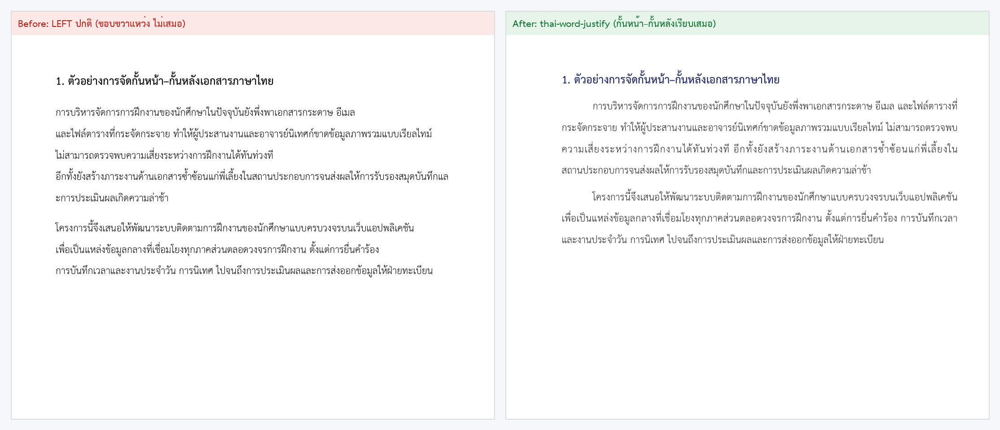

# thai-word-justify

Agent Skill สำหรับจัดหน้าเอกสาร Microsoft Word (`.docx`) ภาษาไทยให้กั้นหน้า–กั้นหลังเรียบเสมอระดับสิ่งพิมพ์ราชการ/องค์กร ใช้งานได้ทั้งใน **Google Gemini (Chat / Web / Gems)** และ **Google Antigravity / Gemini CLI**

> Publication-grade Thai Microsoft Word (`.docx`) justification skill (`thaiDistribute` / `THAI_JUSTIFY`, standard Thai A4 `3.0 / 2.0 cm` margins, `TH Sarabun New 16pt`, `w:bidi="th-TH"`, punctuation-safe ZWSP, layout presets, table-overflow auditing, and MS Word / LibreOffice visual QA).

---

## ผลลัพธ์จริงใน Microsoft Word (Before / After)



---

## เลือกแพ็กเกจให้เหมาะกับสภาพแวดล้อม (2 Editions)

| แพ็กเกจ | ไฟล์ดาวน์โหลด | โครงสร้าง | เหมาะสำหรับ |
| :--- | :--- | :--- | :--- |
| **Gemini / Script-Free Edition** | [`thai-word-justify-gemini.zip`](https://github.com/seree999-dot/thai-word-justify/releases/latest/download/thai-word-justify-gemini.zip) *(หรือ `thai-word-justify.zip`)* | **Pure Markdown 100%** (ไม่มีไฟล์สคริปต์ `.py` — พร้อม Inline `python-docx` Recipe ใน `references/ooxml-thai-guide.md`) | **Google Gemini (Chat / Web / Gems)** และสภาพแวดล้อมที่ไม่อนุญาตให้มี executable scripts รวมถึงใช้ใน **Google Antigravity** ได้ทันที |
| **Full CLI Edition** | [`thai-word-justify-cli.zip`](https://github.com/seree999-dot/thai-word-justify/releases/latest/download/thai-word-justify-cli.zip) | มีสคริปต์ Python CLI (`fix`, `check`), Presets (`proposal`, `official`, `academic`) และ `render_docx_to_png.py` ตรวจภาพผ่าน MS Word/LibreOffice | **Google Antigravity**, **Gemini CLI** และเครื่องที่รัน Python ได้ |

---

## Presets มาตรฐานเอกสารไทย (3 รูปแบบ)

| Preset | ระยะขอบ (ซ้าย / ขวา / บน / ล่าง) | ความกว้างพื้นที่เนื้อหา | เลขหน้า |
| :--- | :--- | :--- | :--- |
| `proposal` *(ค่าเริ่มต้น)* | `3.0 / 2.0 / 2.5 / 2.0 ซม.` | `16.0 ซม.` | กึ่งกลางท้ายกระดาษ (`หน้า X / Y`) |
| `official` *(หนังสือราชการ)* | `3.0 / 2.0 / 2.5 / 2.0 ซม.` | `16.0 ซม.` | มุมขวาบน (รองรับเลขไทย `๐–๙`) |
| `academic` *(รายงาน/วิทยานิพนธ์)* | `3.81 / 2.54 / 2.54 / 2.54 ซม.` | `14.65 ซม.` | มุมขวาบน |

---

## ความสามารถหลัก (Features)

- **กั้นหน้า–กั้นหลังภาษาไทยแท้ (`thaiDistribute`)**: ใช้ `WD_ALIGN_PARAGRAPH.THAI_JUSTIFY` ร่วมกับ `w:lang w:bidi="th-TH"` บนย่อหน้าบรรยายและ Callout เพื่อไม่ให้ช่องว่างหรือตัวอักษรถ่างผิดปกติ
- **ตัดคำไทยอย่างปลอดภัย (`U+200B`)**: แทรก Zero-Width Space แบบ Idempotent (ป้องกันซ้ำซ้อนและไม่ตัดหน้า `ๆ`, `ฯ`)
- **ตรวจความถูกต้องอัตโนมัติ (`check`)**: ตรวจขนาด A4, ระยะขอบ, `THAI_JUSTIFY`, `w:bidi="th-TH"`, `w:cs`, ZWS และตรวจจับ **ตารางล้นขอบ (`Table Width Overflow`)**
- **ฟอนต์ Complex Script (`TH Sarabun New`)**: ตั้งค่า `w:ascii`, `w:hAnsi`, `w:cs`, `w:szCs` และ `w:bCs` ครบถ้วน
- **Inline `python-docx` Recipe**: มีโค้ดสำเร็จรูป ~35 บรรทัดใน [`references/ooxml-thai-guide.md`](./references/ooxml-thai-guide.md) สำหรับสภาพแวดล้อม Sandbox ที่ไม่มีสคริปต์แยก

---

## การติดตั้ง (Installation)

### 1. สำหรับ Google Gemini (Chat / Web / Gems)
ดาวน์โหลด **`thai-word-justify-gemini.zip`** (ไม่มีไฟล์สคริปต์รันแยก) จาก [GitHub Releases](https://github.com/seree999-dot/thai-word-justify/releases/latest) แล้วอัปโหลดติดตั้งใน Google Gemini ได้ทันที

### 2. สำหรับ Google Antigravity / Gemini CLI
```bash
# Google Antigravity (Global)
git clone https://github.com/seree999-dot/thai-word-justify.git ~/.gemini/config/skills/thai-word-justify

# หรือ Gemini CLI (User-level)
git clone https://github.com/seree999-dot/thai-word-justify.git ~/.gemini/skills/thai-word-justify
```

ติดตั้ง Python dependencies เพิ่มเติมหากใช้ Full CLI Edition:
```bash
pip install -r requirements.txt
```

---

## การใช้งานแบบ CLI และทดสอบ (Full CLI Edition)

```bash
# ปรับกั้นหน้า-กั้นหลังด้วย Preset (proposal / official / academic)
python scripts/thai_word_justify.py fix input.docx -o output.docx --preset proposal --footer "ชื่อเอกสาร"
python scripts/thai_word_justify.py fix input.docx -o official.docx --preset official --thai-numerals

# ตรวจสอบมาตรฐานเอกสารและตารางล้นขอบ (exit code 0 = ผ่าน)
python scripts/thai_word_justify.py check output.docx

# เรนเดอร์เป็นภาพ PNG ทุกหน้าเพื่อตรวจผลจริง
python scripts/render_docx_to_png.py output.docx ./preview_png --dpi 150

# รัน Unit Tests
python -m unittest discover -s tests -v
```

ดูตัวอย่างการสร้างเอกสารใหม่ได้ที่ [`examples/quick_example.py`](./examples/quick_example.py) และคู่มือ OOXML + Inline Recipe ได้ที่ [`references/ooxml-thai-guide.md`](./references/ooxml-thai-guide.md)

## License

MIT License — see [LICENSE](./LICENSE).
